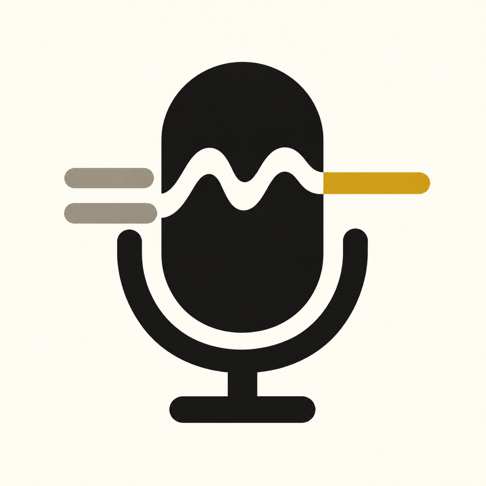
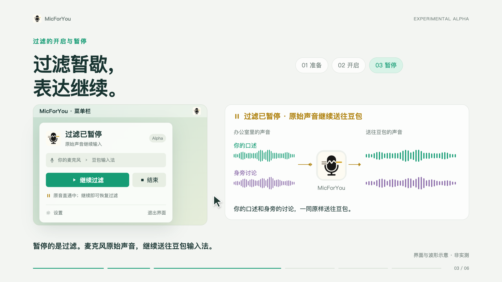

# MicForYou

English · [简体中文](README.md)



**A shared space. A clearer voice.**

Dictate a proposal at an open desk without giving every nearby conversation a place in your sentence. MicForYou uses your enrolled voice as a reference to process microphone audio locally on your Mac, reducing some nearby speech and environmental interference before sending it to Doubao IME for transcription.

This **Experimental Alpha** is for Mac users comfortable with a hands-on setup. Distribution is planned through GitHub; there is no App Store version. **The app is a menu-bar controller: you still need a local Python runtime, model, voice enrollment, and BlackHole 2ch. Downloading the `.app` alone does not complete installation.**

## Watch the demo

[](docs/media/micforyou-promo-latest.mp4)

[Watch / download the latest demo (MP4, 55 seconds)](docs/media/micforyou-promo-latest.mp4). Download it from the GitHub file page to play it locally. The interface, transcription, and waveforms are animated illustrations, not measured before/after results. The film is currently in Chinese.

## Hardware and performance requirements

**Use the validated MacBook Air M5 as the current recommended baseline. The tested M1 did not meet this model's real-time requirements and is not recommended for filtering.** Other devices must pass local performance checks, even with newer chips or higher specifications. A chip name alone does not guarantee acceptable latency.

| Requirement / device | Current requirements and results |
| --- | --- |
| OS and architecture | The menu-bar UI requires **macOS 14+**. The current build targets **Apple Silicon (arm64)**; Intel is unverified. |
| MacBook Air M5 | Previously passed a [30-minute run](docs/MAC_A_NEXT_STAGE.md), with internal bridge audio latency p95 around **260 ms**. This is the validated baseline; workload and power conditions still affect results. |
| MacBook Pro M1 (tested device) | The current REAL-TSE checkpoint's best valid RTF was **1.052**: processing was slower than real time and could not keep up with continuous audio input. Real-time filtering is currently unsupported on this tested device. |
| Other Macs | Insufficient validation, including other generations and Pro / Max / Ultra variants. Devices with comparable or greater sustained processing capacity are candidates, but must still pass performance checks. |

Complete the [local performance checks in installation step 5](docs/INSTALL.en.md) during installation. Recommended candidates need **RTF ≤ 0.80** (processing time / audio duration, leaving at least 20% throughput headroom), **internal bridge latency p95 < 400 ms** in paced verification, and no FAULT or sustained audio underruns. Use AC power and verify under your usual workload: heavy background work can turn a passing configuration into a failing one. See the [performance guide](docs/PERFORMANCE_GUIDE.md) and [M1 test results](docs/MAC_B_COREML_THREAD_RECHECK_RESULTS_20260918.md).

**These latency figures measure MicForYou's audio path, excluding Doubao recognition and text display. They are not a promise of end-to-end dictation latency.** The earlier M5 validation is also not a hardware acceptance test for the new pause behavior.

## Download and install

Follow the [complete installation guide](docs/INSTALL.en.md), in this order:

1. Download the source and install `uv` and Apple Command Line Tools.
2. Install BlackHole 2ch and restart your Mac. This is the audio-routing component required for voice input.
3. Prepare the REAL-TSE source and independently obtained weights in a separate Python environment.
4. Enroll your voice using your everyday microphone, export and validate a personalized ONNX model locally, and save the configuration.
5. Build and install the menu-bar app in `~/Applications`, then select `BlackHole 2ch` as Doubao's input.

Repository: [chenerzhong123-cloud/micforyou](https://github.com/chenerzhong123-cloud/micforyou). It is currently private, with **no published Release or public installer**. Repository access is required. Once you have access:

```bash
git clone https://github.com/chenerzhong123-cloud/micforyou.git
cd micforyou
uv sync --extra dev
```

Alternatively, use **Code → Download ZIP** on GitHub and open the extracted source directory. This ZIP does not include Python environments, weights, or voice enrollment. Keep the source directory after installation: the app invokes the controller from the configured source location.

When prebuilt packages are available, download `.app.zip` from **Assets** on [GitHub Releases](https://github.com/chenerzhong123-cloud/micforyou/releases). The automatically generated `Source code (zip)` is not an app installer. A menu-bar package still requires runtime setup. Current builds are ad-hoc signed, without Developer ID signing or notarization. If macOS blocks first launch, follow [Apple's instructions](https://support.apple.com/en-us/102445) to use **System Settings → Privacy & Security → Open Anyway** for an app whose source you have verified.

## Everyday use

After setup, open the MicForYou menu, choose “开始过滤” (Start filtering), wait for “正在过滤” (Filtering), then dictate using Doubao. The app interface currently uses Chinese labels.

| Action | Audio sent to the IME | Microphone |
| --- | --- | --- |
| Start filtering | Processed audio; silence until loading completes | In use |
| Pause filtering | **Raw audio continues, including your voice, nearby people, and surroundings** | Still in use |
| Resume filtering | Fresh streaming state restores filtering without reopening devices | Still in use |
| End | No audio from this route | Released |
| Quit interface | Background audio continues in its current mode | Still in use while running or paused |

Pause stops filtering, not capture. Choose “结束” (End) to release the microphone before quitting, changing microphones, or enrolling again. Pause/resume does not require reselecting Doubao's input device.

Terminal users can run these commands from the project directory:

```bash
uv run micforyou status
uv run micforyou start
uv run micforyou pause   # raw audio continues; microphone stays open
uv run micforyou resume  # restore filtering
uv run micforyou stop    # end and release the microphone
```

MicForYou never changes the system's default input automatically. If Doubao lacks its own input selector, manually choose BlackHole in **System Settings → Sound → Input**, and restore your physical microphone afterward if needed. Keep the system output on your usual speakers/headphones.

## Support and limitations

- Filtering reduces some other speech but **cannot guarantee isolation**. Other people may still be transcribed while you are silent. This is not an identity-verification or privacy-isolation tool.
- Raw passthrough on pause has automated and real-ONNX/synthetic-input checks. Physical-device transitions, Doubao experience, and a new 30-minute stability test remain pending. See the [validation record](docs/PAUSE_PASSTHROUGH_VALIDATION.md).
- Model weights are not included in the source or menu-bar package. A unified redistribution license for the current REAL-TSE weights remains unclear; obtain them from upstream yourself and follow their conditions. See [model provenance and license notes](docs/STAGE_B.md#license-boundary).

## Local data and faults

MicForYou processes and enrolls audio locally. It does not perform ASR or type text. Doubao's recognition and data handling follow its own policies; local preprocessing does not make the complete dictation flow offline.

The default runtime-fault policy is silence. An explicit pause enables raw passthrough, with a different visible state. A fault is never silently treated as a user pause. If the selected microphone disappears, the app does not automatically choose another microphone.

Configuration and runtime metadata live in `~/Library/Application Support/MicForYou/`; new reports use its `work/runs/` directory. Logs contain no audio, embeddings, or IME text. Enrollment audio and personalized ONNX files remain in your chosen local directories; do not commit them to GitHub.

## Update, troubleshoot, and uninstall

Choose End and quit the interface before updating the source/controller:

```bash
git pull --ff-only
uv sync --extra dev
./app/MicForYouMenuBar/install_app.sh
```

This preserves configuration, models, and enrollment. Older versions released capture on pause. Upgrading does not automatically reopen the microphone; explicitly start filtering again. Do not replace runtime files while raw output is active.

- Setup incomplete: run `uv run micforyou status` and check missing paths/device names.
- No text: check readiness, Doubao's `BlackHole 2ch` selection, and macOS microphone permission for the process actually capturing audio.
- Microphone still active: pause and quitting the interface preserve audio. Choose End or run `uv run micforyou stop`.
- Uninstall: end audio, quit, move `~/Applications/MicForYou.app` to Trash, and restore Doubao's input. Configuration, enrollment, and BlackHole are separate resources; back up or remove them as needed.

[Installation](docs/INSTALL.en.md) · [Menu-bar guide](docs/MENU_BAR_APP.md) · [Performance checks](docs/PERFORMANCE_GUIDE.md) · [Development history](docs/DEVELOPMENT_HISTORY.md) · [Video source](video/README.md)
